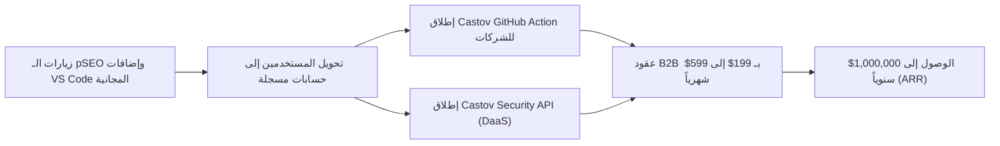

# 🚀 دليل منصة كاستوف الشامل (Castov Platform & Ecosystem Guide)
> **تاريخ التوثيق:** 2026-10-22  
> **الموقع الرسمي:** [https://castov.com](https://castov.com)  
> **مستودع الأكواد:** [GitHub - castovdev/castov](https://github.com/castovdev/castov)  
> **حساب الناشر في متجر مايكروسوفت:** [VS Code Marketplace - Castov](https://marketplace.visualstudio.com/publishers/Castov)

---

## 📑 الفهرس العام
1. [نظرة عامة على المشروع والهوية](#1-نظرة-عامة-على-المشروع-والهوية)
2. [البنية التقنية والمعمارية البرمجية (Tech Stack)](#2-البنية-التقنية-والمعمارية-البرمجية-tech-stack)
3. [محركات الـ Programmatic SEO (pSEO) المليونية](#3-محركات-الـ-programmatic-seo-pseo-المليونية)
   - محرك فحص وتدقيق أمان حزم NPM
   - محرك المقارنات المباشرة بين المكتبات (NPM Compare)
   - محرك المجدول الزمني (Cron Expressions)
   - محرك صلاحيات الملفات (Chmod Calculator)
   - محرك التوقيت العالمي والـ Unix Epoch
   - محرك بروتوكول HTTP وأكواد الاستجابة
   - محركات الشبكات (CIDR & Ports) وأخطاء البرمجة (Error Fixes)
4. [حزمة إضافات VS Code الـ 13 الرسمية على متجر مايكروسوفت](#4-حزمة-إضافات-vs-code-الـ-13-الرسمية-على-متجر-مايكروسوفت)
5. [أدوات المطورين التفاعلية (60+ Web Tools)](#5-أدوات-المطورين-التفاعلية-60-web-tools)
6. [نظام الـ SEO والخرائط وملفات الروبوت (Sitemaps & Robots)](#6-نظام-الـ-seo-والخرائط-وملفات-الروبوت-sitemaps--robots)
7. [أدوات منظومة المطورين (CLI, SDK, MCP, Chrome Extension)](#7-أدوات-منظومة-المطورين-cli-sdk-mcp-chrome-extension)
8. [خريطة تحقيق الأرباح والمليون دولار (Monetization Strategy)](#8-خريطة-تحقيق-الأرباح-والمليون-دولار-monetization-strategy)

---

## 1. نظرة عامة على المشروع والهوية
منصة **كاستوف (Castov)** هي منصة برمجية موحدة مصممة للمطورين وفرق البرمجة وشركات التقنية حول العالم. تهدف المنصة إلى تسريع دورة حياة تطوير البرمجيات وحمايتها من هجمات سلاسل التوريد (Supply Chain Security)، مع تقديم أدوات مجانية عالية السرعة تعمل داخل المتصفح وبشكل محلي في محررات الأكواد (VS Code & Cursor).

* **شعار المنصة:** سريعة، تركز على الخصوصية (Client-First)، بدون تسجيل أو إعلانات مزعجة.
* **الترخيص:** مفتوح المصدر برخصة MIT للمشاريع المجتمعية.

---

## 2. البنية التقنية والمعمارية البرمجية (Tech Stack)
* **إطار العمل الرئيسي:** Next.js (App Router الحديث مع دعم Server Components و Client Components).
* **لغة البرمجة:** TypeScript بالكامل مع فحص صارم للأنواع (`npm run typecheck` بنسبة خلو من الأخطاء 100%).
* **واجهة المستخدم والتصميم:** Tailwind CSS مع نظام ألوان موحد (Dark/Light Mode) ومكونات Lucide Icons.
* **الأداء والسرعة:** توليد مسبق للصفحات الثابتة (Static Generation / SSG) وتحديث تدريجي فائق السرعة (ISR) لضمان أوقات استجابة أقل من 50ms.
* **معايير الأمان للبيانات:** تشفير محلي للبيانات في المتصفح باستخدام Web Crypto API (AES-GCM 256-bit) لمنع وصول الخوادم للبيانات الحساسة.

---

## 3. محركات الـ Programmatic SEO (pSEO) المليونية
تم بناء استراتيجية كسب ملايين الزيارات عبر محركات البحث (Organic Traffic) من خلال إنشاء صفحات ديناميكية عالية الجودة تجيب عن أسئلة المطورين الأكثر بحثاً في Google:

### أ) محرك فحص أمان حزم NPM (`/npm` و `/npm/[...package]`)
* **الوصف:** فحص فوري ومباشر لأي حزمة في مستودع NPM الرسمي (أكثر من 2 مليون حزمة).
* **الميزات الفنية:**
  - سحب حي لبيانات الحزمة من NPM Registry و NPM Downloads API.
  - دعم كامل للحزم ذات النطاقات المحددة (Scoped Packages مثل `@types/node` و `@google/genai`).
  - **خوارزمية كشف هجمات التسمية الخادعة (Typosquatting Detector):** حساب مسافة Levenshtein بين اسم الحزمة وأشهر 120 حزمة عالمية لكشف محاولات الاختراق.
  - **كشف البرمجيات النصية أثناء التثبيت (Install Scripts Risk):** فحص وجود نصوص `preinstall` أو `postinstall` التي قد تنفذ أوامر ضارة في خوادم الشركات.
  - **تحليل التراخيص (License Compliance):** التمييز التلقائي بين التراخيص المتساهلة (Permissive مثل MIT و Apache) والتراخيص المشددة (Copyleft مثل GPL و AGPL) التي تجبر الشركات على فتح كودها.
  - **حساب درجة الأمان (Security Score & Grade):** تقييم من 0 إلى 100 مع منح درجة (A+, A, B, C, D, F) ومستوى خطر (Safe, Low, Medium, High, Critical).
  - كشف عدد المطورين المساهمين ومخاطر المطور الفردي (Single Maintainer Risk).
  - حساب حجم الحزمة بعد فك الضغط (Unpacked Size) وعدد الحزم التابعة (Dependencies).

### ب) محرك المقارنات المباشرة بين المكتبات (`/npm/compare` و `/npm/compare/[...slug]`)
* **الوصف:** مقارنة تفصيلية جنباً إلى جنب (Head-to-Head) لأكثر من 100+ ثنائية برمجية شهيرة مع شريط بحث تفاعلي لمقارنة أي حزمتين في العالم.
* **أمثلة المقارنات المدعومة تلقائياً:**
  - `react-vs-vue`, `express-vs-fastify`, `pnpm-vs-npm`, `prisma-vs-drizzle-orm`, `zustand-vs-redux`, `jest-vs-vitest`, `@types/node-vs-typescript`.
* **جدول المقارنة يشمل:**
  - عدد التحميلات الأسبوعية مع وسم الفائز (Downloads Winner).
  - حجم الحزمة وتوافق TypeScript (.d.ts Native).
  - تقييم الأمان وخلو نصوص التثبيت والتراخيص القانونية.
  - أوامر التثبيت بنقرة واحدة (1-Click Install Command).
  - بانر ترويجي تحويلي لتحميل إضافة VS Code لزيادة التثبيتات.

### ج) محرك المجدول الزمني Cron Expressions (`/cron` و `/cron/[expression]`)
* تفسير أي صيغة Cron (مثل `0_0_*_*_*`) إلى لغة بشرية مفهومة بدقة.
* حساب مواعيد التنفيذ الخمسة القادمة.
* توليد آلي لـ FAQ Schema وبيانات منظمة لكل تعبير زمني.

### د) محرك صلاحيات الملفات Chmod Calculator (`/chmod` و `/chmod/[code]`)
* فحص وتوليد جميع تركيبات الصلاحيات الـ 512 في أنظمة لينكس ويونكس (من `000` إلى `777`).
* تمثيل تفاعلي للصلاحيات (Owner, Group, Public) بنظام القراءة (Read)، الكتابة (Write)، والتنفيذ (Execute).
* توضيح المخاطر الأمنية لكل كود (مثل خطورة استخدام `chmod 777`).

### هـ) محرك التوقيت والـ Unix Epoch (`/unix` و `/unix/[timestamp]`)
* تحويل فوري للطوابع الزمنية بالثواني والميلي ثانية.
* حساب الوقت المنقضي والمتبقي (Relative Time).
* تغطية أهم التواريخ التاريخية والمستقبلية (مثل مشكلة عام 2038 Y2038 Bug).

### و) موسوعة أكواد HTTP وأخطاء المطورين
* **دليل أكواد HTTP (`/http-status/[code]`):** شروحات تفصيلية لكافة أكواد الاستجابة من 100 إلى 599 مع أمثلة وحلول لمشاكل الخوادم.
* **موسوعة حلول الأخطاء (`/error-fixes/[slug]`):** 69 دليلاً مفصلاً لحل أكثر رسائل الـ Stack Traces شيوعاً في Node.js, Python, React.
* **مختبر تعابير Regex (`/regex-patterns/[slug]`):** 40 نمطاً جاهزاً للبريد الإلكتروني، كلمات المرور، الـ URLs، مع محرك تجربة حي.
* **حاسبة الشبكات وعناوين CIDR (`/cidr/[mask]`):** حساب الـ Subnet Masks، وعناوين البث (Broadcast)، وعدد الأجهزة المتاحة.
* **دليل منافذ الشبكات (`/ports/[port]`):** أكثر من 60 منفذاً مشهوراً وشرح استخدامها ومخاطرها.

---

## 4. حزمة إضافات VS Code الـ 13 الرسمية على متجر مايكروسوفت
تم بناء ونشر 13 إضافة متخصصة بشكل مستقل على [VS Code Marketplace](https://marketplace.visualstudio.com/publishers/Castov):

| الإضافة | الاسم البرمجي (Identifier) | الوظيفة والدور الأساسي | رابط المتجر المباشر |
| :--- | :--- | :--- | :--- |
| 🛡️ **Dependency Risk Lens** | `Castov.dependency-lens-castov` | كشف ثغرات التبعيات، هجمات Typosquatting، وتراخيص الحزم داخل ملفات `package.json` | [تثبيت في المتجر](https://marketplace.visualstudio.com/items?itemName=Castov.dependency-lens-castov) |
| 🔒 **MCP Security Scanner** | `Castov.mcp-security-castov` | فحص أمان إعدادات Model Context Protocol وكشف تسريب الـ API Keys وحقن الأوامر | [تثبيت في المتجر](https://marketplace.visualstudio.com/items?itemName=Castov.mcp-security-castov) |
| 🔤 **Bidi & Unicode Guard** | `Castov.bidi-guard-castov` | حماية الكود من هجمات الـ Trojan Source وكشف الحروف المخفية وUnicode المتلاعب بها | [تثبيت في المتجر](https://marketplace.visualstudio.com/items?itemName=Castov.bidi-guard-castov) |
| 🩺 **Env Doctor** | `Castov.env-doctor-castov` | فحص ملفات `.env`، كشف المفاتيح المسربة، وتوليد أمثلة `.env.example` آمنة | [تثبيت في المتجر](https://marketplace.visualstudio.com/items?itemName=Castov.env-doctor-castov) |
| 🪙 **Token Lens** | `Castov.token-lens-castov` | حساب عدد الـ Tokens وتكلفة الاستهلاك بالدولار لنماذج GPT-4o, Claude 3.5, Gemini في الكود | [تثبيت في المتجر](https://marketplace.visualstudio.com/items?itemName=Castov.token-lens-castov) |
| ✨ **Prompt Tester** | `Castov.prompt-tester-castov` | اختبار وتقييم الـ System Prompts وإجراء unit tests على إجابات الذكاء الاصطناعي | [تثبيت في المتجر](https://marketplace.visualstudio.com/items?itemName=Castov.prompt-tester-castov) |
| 🤖 **AI Blame** | `Castov.ai-blame-castov` | عدسة Git توضح بدقة السطور المكتوبة بواسطة مبرمج بشري وتلك المولدة بـ Copilot أو Cursor | [تثبيت في المتجر](https://marketplace.visualstudio.com/items?itemName=Castov.ai-blame-castov) |
| ⏳ **Agent Replay** | `Castov.agent-replay-castov` | فحص خط زمني مرئي لتنفيذ وكلاء الذكاء الاصطناعي (AI Agents Trajectories & Steps) | [تثبيت في المتجر](https://marketplace.visualstudio.com/items?itemName=Castov.agent-replay-castov) |
| 🖥️ **MCP Inspector** | `Castov.mcp-inspector-castov` | فحص واختبار سيرفرات MCP ومراقبة حركة JSON-RPC المباشرة في المحرر | [تثبيت في المتجر](https://marketplace.visualstudio.com/items?itemName=Castov.mcp-inspector-castov) |
| 🪝 **Webhook Catcher** | `Castov.webhook-catcher-castov` | استقبال واختبار الـ Webhooks (Stripe, GitHub) محلياً في المحرر بدون الحاجة لـ ngrok | [تثبيت في المتجر](https://marketplace.visualstudio.com/items?itemName=Castov.webhook-catcher-castov) |
| 🔥 **Chaos Proxy** | `Castov.chaos-proxy-castov` | محاكاة أخطاء الشبكة، التأخير الزمني (Latency)، وإسقاط الاتصالات لاختبار مرونة التطبيق | [تثبيت في المتجر](https://marketplace.visualstudio.com/items?itemName=Castov.chaos-proxy-castov) |
| 📊 **Log Story** | `Castov.log-story-castov` | تحويل سجلات الخادم المعقدة والـ Distributed Traces إلى سرد بصري سهل الفهم | [تثبيت في المتجر](https://marketplace.visualstudio.com/items?itemName=Castov.log-story-castov) |
| ⚡ **Castov Developer Suite** | `castov.castov-vscode` | الإضافة الرئيسية: تحويل التوقيت بالوقوف فوق الرقم، توليد UUID v4/v7، وفك شفرة JWT | [تثبيت في المتجر](https://marketplace.visualstudio.com/items?itemName=castov.castov-vscode) |

* **صفحة الدليل المحدثة في الموقع:** تضم جميع الروابط الرسمية وأوامر التثبيت من الـ Terminal على الرابط: `https://castov.com/extension`.

---

## 5. أدوات المطورين التفاعلية (60+ Web Tools)
تتضمن المنصة أكثر من 60 أداة تفاعلية تعمل داخل المتصفح بنسبة 100% دون إرسال البيانات للخادم:
1. **JSON to TypeScript Converter:** تحويل JSON فورياً إلى واجهات TypeScript Interfaces مع دعم حفظ ومشاركة الحالة في الرابط (Shareable Hash State).
2. **Text & Code Diff Checker:** مقارنة نصوص وأكواد برمجية سطراً بسطر مع إبراز الاختلافات وميزة مشاركة الرابط.
3. **UUID Generator:** توليد معرفات عشوائية (v4) ومعرفات مرتبة زمنياً مخصصة لقواعد البيانات (v7).
4. **JWT Decoder & Inspector:** فحص التوكنات وعرض الـ Header و Payload وحالة الصلاحية (Expiration).
5. **Base64 & URL Encoder/Decoder:** تشفير وفك تشفير النصوص والملفات الثنائية.
6. **Hash & HMAC Generator:** توليد بصمات MD5, SHA-1, SHA-256, SHA-512 مع مفاتيح سرية.
7. **cURL Converter:** تحويل أوامر cURL إلى كود برمجي (JavaScript Fetch, Axios, Python Requests, Go).
8. **Env Vault:** مشاركة أسرار الـ `.env` بين أعضاء الفريق بتشفير طرفي كامل (End-to-End Encryption).
9. **Webhook Tester:** توفير Endpoint تجريبي لاستقبال وفحص طلبات الـ HTTP والـ Webhooks في الوقت الفعلي.
10. **Timezone Converter & World Clock:** تحويل التوقيت بين عواصم ومدن العالم مع تمثيل بصري لمواعيد العمل المشتركة.

---

## 6. نظام الـ SEO والخرائط وملفات الروبوت (Sitemaps & Robots)
تم بناء معمارية SEO تتيح لمحركات البحث (Googlebot) الزحف إلى مئات الآلاف من الروابط بسهولة فائقة دون التأثير على أداء الخادم:
* **ملف الروبوت الرئيسي:** `https://castov.com/robots.txt`
* **خرائط الموقع المتخصصة (XML Sitemaps):**
  1. `https://castov.com/sitemap.xml`: الصفحات الرئيسية والأدوات.
  2. `https://castov.com/sitemap-npm.xml`: صفحات فحص حزم NPM الأكثر بحثاً (120+ حزمة).
  3. `https://castov.com/sitemap-compare.xml`: صفحات المقارنة المباشرة بين المكتبات (100+ مقارنة).
  4. `https://castov.com/sitemap-cron.xml`: آلاف تعابير الجدولة الزمنية.
  5. `https://castov.com/sitemap-chmod.xml`: جميع صلاحيات Chmod الـ 512.
  6. `https://castov.com/sitemap-http-status.xml`: صفحات أكواد بروتوكول HTTP.
  7. `https://castov.com/sitemap-unix.xml`: الطوابع الزمنية التاريخية والحديثة.
* **معايير الأمان للخرائط:** تدعم التوليد الثابت `force-static` وتشفير المحارف الخاصة عبر `xmlEscape` مع كاش يومي 86400 ثانية.

---

## 7. أدوات منظومة المطورين (CLI, SDK, MCP, Chrome Extension)
* **Castov CLI (`packages/castov-cli`):** أداة سطر أوامر للمطورين للتحويلات السريعة وفحص الحزم من الـ Terminal.
* **Castov SDK (`packages/castov-sdk`):** حزمة برمجية مخصصة لدمج ميزات كاستوف في مشاريع Node.js و TypeScript.
* **Castov MCP Server (`src/app/mcp/page.tsx`):** سيرفر Model Context Protocol متوافق لربط كاستوف بمساعدات الذكاء الاصطناعي (Claude Desktop, Cursor).
* **إضافة المتصفح (Chrome/Edge Extension):** إضافة منبثقة (Popup Companion) تتيح استخدام الأدوات دون مغادرة صفحة العمل.

---

## 8. خريطة تحقيق الأرباح والمليون دولار (Monetization Strategy)
خارطة طريق واضحة تعتمد على رياضيات الـ B2B SaaS وبيع واجهات البيانات (Data-as-a-Service):

1. **المنتج الأول: Castov Security API (Data-as-a-Service)**
   - بيع إمكانية فحص الحزم والتراخيص والـ Typosquatting برمجياً للشركات عبر API سريع.
   - خطة المطورين: 99\$/شهر (100,000 طلب).
   - خطة الشركات: 299\$/شهر (500,000 طلب).
   - **الهدف:** 300 شركة فقط تشترك في الـ API = **1,000,000\$ سنوياً**.
2. **المنتج الثاني: Castov Gatekeeper (GitHub Action للشركات)**
   - فحص آلي في الـ CI/CD لكل Pull Request لمنع تثبيت الحزم التي تحتوي على فيروسات أو نصوص تثبيت خبيثة.
   - اشتراك 199\$/شهر للفريق الصغير و 599\$/شهر للشركات.
3. **المنتج الثالث: Castov Team Vault في VS Code**
   - ترقية مدفوعة لمشاركة الـ `.env` وإعدادات الـ MCP بأمان تام بين أفراد الفريق الواحد داخل المحرر.

---

*تم حفظ هذا الدليل ليكون مرجعاً تقنياً شاملاً لكافة منجزات المنصة ومسارات نموها المستقبلية.*
